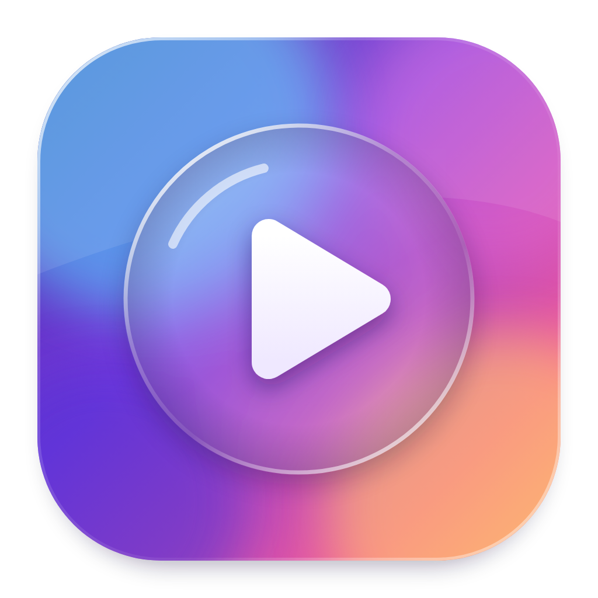
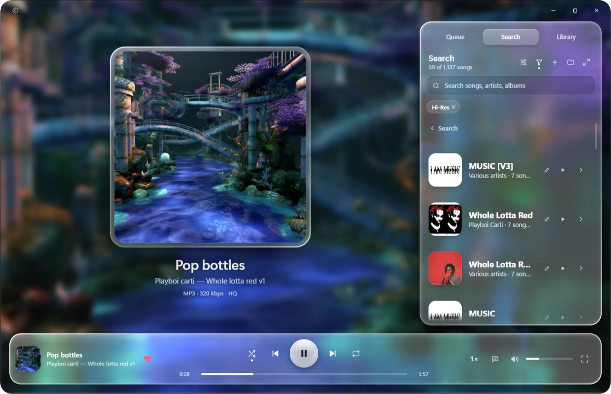
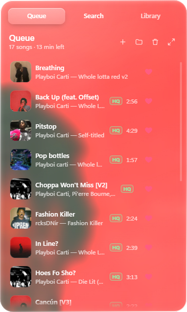

<p align="center">
  
</p>

<h1 align="center">Glassy</h1>

<p align="center">A liquid-glass music and video player for the files on your computer.</p>

<p align="center">
  <a href="https://github.com/pxlarized2/glass-player/releases/latest"><b>Download</b></a> ·
  <a href="#features">Features</a> ·
  <a href="#more-soon">More soon</a> ·
  <a href="#our-vision">Our vision</a> ·
  <a href="#contact">Contact</a>
</p>

<p align="center">
  <a href="https://github.com/pxlarized2/glass-player/releases/latest"></a>
  
</p>



## What it is

Glassy plays the music and videos you already have. Point it at your files and you get a library, synced lyrics and sound you can shape, in a window made of glass panels that bend whatever sits behind them.

There's no account and no subscription. Glassy doesn't come with any music, it plays the files you give it. It goes online to look up lyrics, artist info and covers (it sends the song or artist name) and to check for updates. Your files stay on your computer.

## Features



### The look

- Glass panels that bend the background near their edges and frost the middle, with a bright rim. A lighter Frosted style is there for older computers.
- Three backgrounds: moving colours, the playing song's cover, or a picture of your own, with a blur slider.
- Tint every panel with any colour you like.
- A soft shadow over only the bright parts of a cover, so white patches can't wash out the text.
- Little bars on the playing song that follow its kicks and hi-hats.

### Your library

- Queue, Search and Library tabs, with albums, artists, folders, playlists and favorites.
- Search that forgives typos. Type `#tagname` to search by tag.
- A quality badge on every song: Hi-Res, CD, HQ, SQ or LQ. You can filter by them too.
- Your own tags, each with a name and a colour.
- Artist pages with a photo, a short bio from Wikipedia, most played songs and albums.
- Undo for whatever you just did.
- Stays fast with 10,000 songs.

### Fixing your files

- Edit titles, artists and albums, saved back into your MP3s. Find online fills in the details for you.
- Real artist suggestions with photos as you type, and collabs split into the people on them.
- A cover tool: move, zoom, fit, or borrow the art from another song.
- Drag one song onto another to make an album.

### Lyrics

- Synced lyrics that follow the song. Click a line to jump to it.
- Lyrics from a `.lrc` or `.txt` next to the song, the song's own tags, LRCLIB, Kugou and NetEase.
- Search as you type, pick the right match, and remove a wrong one.
- Lyrics sit beside the cover, or take over the panel with the cover in the corner when space is tight.

### Sound and playback

- Gapless playback: albums run from song to song with no gap and no click.
- Bass, treble, reverb (room, plate or hall) and an equalizer curve you drag with your mouse.
- Even out volume, on by default, so quiet songs come up and loud ones settle down.
- Each song can fade in and out. Speed goes from 0.75× to 2× and keeps the pitch.
- When the queue runs low, Autoplay adds similar songs from your library.
- Sleep timer, media keys, and video with fullscreen.
- Music: mp3, m4a, flac, wav, ogg, opus. Video: mp4, m4v, webm, mkv, mov.

### Updates

On Windows, Glassy downloads new versions quietly and a small card asks you to restart when one is ready. Settings has a What's new section with every change.

## Download

**[Get the latest version](https://github.com/pxlarized2/glass-player/releases/latest)** and pick the file for your computer:

| Your computer | File | Updates |
|---|---|---|
| Windows | `Glassy-Setup-<version>.exe` | Updates itself in the background |
| Windows, no install | `Glassy-<version>.exe` | Tells you when a new version is out |
| Mac with Apple silicon (M1 or newer) | `Glassy-<version>-mac-arm64.dmg` | Tells you when a new version is out |
| Mac with an Intel chip | `Glassy-<version>-mac-x64.dmg` | Tells you when a new version is out |

To check which Mac you have, open the Apple menu and choose About This Mac. "Chip: Apple" means Apple silicon. The Mac files land on a new release a few minutes after the Windows ones.

### Opening it on a Mac for the first time

Glassy isn't signed with an Apple developer account yet, so macOS stops it the first time:

1. Open the `.dmg` and drag Glassy into Applications.
2. Open Glassy. macOS says it can't check the app. Click **Done**.
3. Open **System Settings → Privacy & Security**, scroll down to the Glassy message, and click **Open Anyway**.

If macOS says the app is "damaged", paste this into Terminal and open it again:

```bash
xattr -cr /Applications/Glassy.app
```

To update on a Mac, download the new version from the card Glassy shows you and drag it over the old one. Your library stays where it is.

## More soon

- An iPhone app
- A song finder on first launch that checks your Music and Downloads folders, shows what it found and lets you pick what goes in
- Word-by-word lyrics
- Smarter Autoplay
- Your library and playlists synced between your devices
- Accounts with safe sign-in
- A community for sharing playlists and extras

## Our vision

The player comes first. It should look as nice as possible, and everything in it should feel seamless.

After that comes the community. Think of a good game with a modding scene: the game is great by itself, and then people keep making extras for it. We want Glassy to grow the same way. It stays a local player at heart, and on top of that you'll be able to share playlists, themes, sound settings, covers and lyric fixes with other people, and take your library with you to your phone.

## Contact

Made by fent.

For inquiries, email [fentisback@gmail.com](mailto:fentisback@gmail.com) or message `@ldig` on Discord.

## Building it yourself

You need [Node.js](https://nodejs.org).

```bash
npm install
```

```bash
npm start
```

To package it, run `npm run dist` on Windows or `npm run dist:mac` on a Mac.

`npm run release` publishes the Windows files, then `.github/workflows/mac.yml` builds, tests and attaches the Mac files on GitHub's Mac machines.
